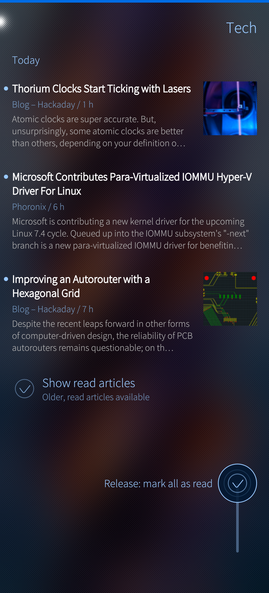
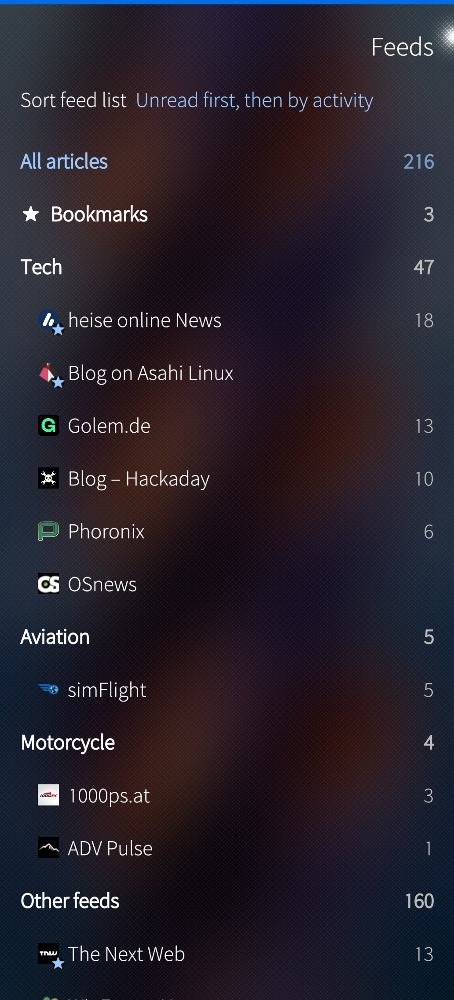
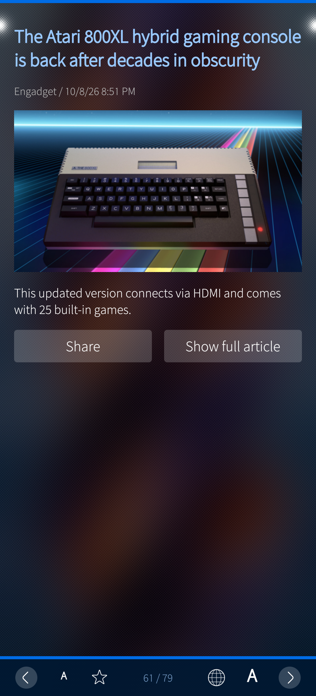
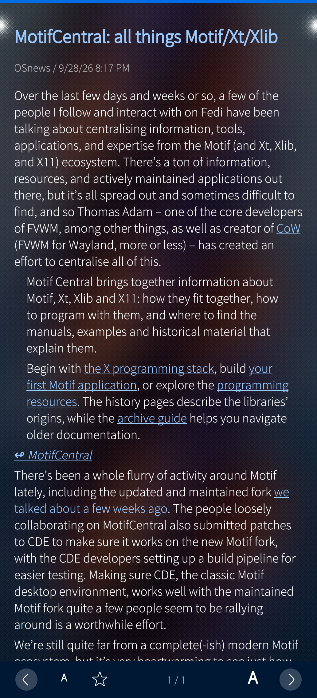
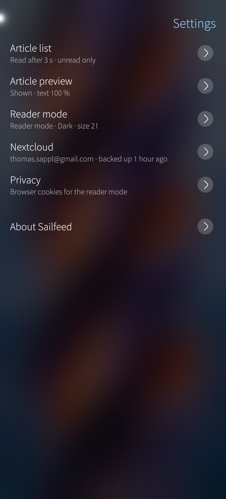

<p align="center">
  
</p>

# Sailfeed

**Nextcloud News client for Sailfish OS.** Sailfeed is a native Nextcloud News client for Sailfish OS

   

> **Why it exists.** I moved partly from Android to Sailfish OS and wanted my RSS feeds in the same
> state on both platforms. For that I now use
> [Nextcloud News](https://apps.nextcloud.com/apps/news) on my own Nextcloud, and for Sailfish OS I
> built this reader for myself, on basis of [libfuoten](https://github.com/Huessenbergnetz/libfuoten).
>
> I built Sailfeed for my own use on my Jolla Phone, around the features I need most in my daily reading
> – one-handed operation, quick/auto "mark as read", a reader mode (based on Readability.js) without ads and cookie banners. 
>
> After using it every day for a while, I want to share it with everyone here and on [OpenRepos](https://openrepos.net/users/tsappl)
>It follows the Harbour rules (sandbox, allowed libraries and APIs), so it installs and runs like a store app. 

<p align="center">
  
  
  
  
  
</p>

## Features

- **Article list** – title, source and age, excerpt and thumbnail, grouped by "Today", "Yesterday" and date; page-wise scrolling that stops at the start of an article (free scrolling on fast flicks); read articles greyed out; optionally unread articles only
- **Reader mode** – using Mozilla's Readability.js: the article's website without ads, cookie banners and overlays; text size, font, line spacing, margins, justified text, colors (ambience, light, dark, sepia) and images adjustable; sites that should always open in the original; pages are preloaded while the preview is displayed, so it opens quickly; consent walls (e.g. "with ads or subscription") are shown once for your choice, which is then remembered
- **Article Preview** - a preview of each article with the option to swipe left to read the article in Reader mode or Full article mode - can be switched off in the Settings
- **Full article** – in reader mode, as the original website in the app (Sailfish WebView) or in the external browser
- **Feed list** – swipe right from the article list: all articles, bookmarks, folders (also empty ones) and feeds with favicons and unread counts, "Other feeds" for feeds without a folder; sorted by unread, name or activity, favorite feeds first in the activity orders
- **Feed management** – add feeds (address from the clipboard) and folders, rename, move and delete them
- **Mark as read** – automatically for articles you have seen for a few seconds (greyed out when you scroll on, or at once); one-handed with a push-up button at the bottom right (like Nextcloud News app on Android); long press for mark as read/unread, bookmark, mark all above or below as read; mark a whole feed or folder from the feed list – all with undo
- **Navigation** – swipe left from the preview into reader mode and right straight back to the list; a one-handed bar in preview and reader mode (previous/next article, text size, bookmark, open in browser); the preview can be skipped; the list keeps its position
- **Settings backup** – settings, favorite feeds and sites in the original (optionally the text sizes) saved in Nextcloud files, automatically after changes, earlier states kept; restore them on another device or after a new installation (offered after signing in), replacing or only adding what is missing, with undo
- **Languages** – English, German
- **Offline-mode** – read and bookmark changes are queued and sent in one go with the next sync, also when the app goes to the background
- **Sailfish native** – Silica components, pulley menus, remorse timers, cover with unread count and refresh action, Sailjail sandbox, app password in Sailfish Secrets

## Planned Features:
- **Landscape mode** - Landscape Mode is already working, but will be refined in future versions (e.g. 2 columns / Article List and Article side-by-side)
- **OPML Import/Export** 
- **Reader / Original mode** - Refinement of the current implementation

## Sign-in

On the sign-in page enter the address of your Nextcloud and choose **Sign in with the browser**: Nextcloud opens, you grant access, and Sailfeed receives its own app password. Alternatively sign in with your user name and an app password created in Nextcloud. Self-signed certificates can be accepted for your own server.

## Requirements

- Sailfish OS 5.x (tested on a Jolla Phone (2026) with 5.1, aarch64)
- A Nextcloud server with the **[Nextcloud News](https://apps.nextcloud.com/apps/news)** app installed (News API v1-2). Sailfeed is only a client and does not fetch feeds itself. If News is not installed yet: as an admin, open *Apps* in your Nextcloud and enable "News" (section *Multimedia*); on hosted Nextclouds this works the same way if the provider allows apps. News needs Nextcloud's background jobs via cron so the feeds are updated. Details: [installation guide](https://nextcloud.github.io/news/install/).
- For the sign-in with an app password instead of the browser: Nextcloud → Settings → Security → Devices & sessions → "Create new app password"

## Installation

- **OpenRepos** – with [Storeman](https://openrepos.net/content/osetr/storeman-installer): search for "Sailfeed", or add the repository of the author (t-sappl) and install it from there.
- **GitHub releases** – download the RPM for your device (`aarch64` for current devices, `armv7hl` for older ones) from the [releases](https://github.com/t-sappl/harbour-sailfeed/releases) and install it ("Allow untrusted software" must be enabled in the settings):

```
devel-su pkcon install-local harbour-sailfeed-*.rpm
```

## Permissions

Sailfeed runs sandboxed (Sailjail) and only asks for:

| Permission | Why |
|---|---|
| Internet | Your Nextcloud server, article websites and images |
| Secrets | Storing the app password encrypted in the system's secure storage (Sailfish Secrets) |

## Privacy

Sailfeed has no tracking and no ads, and the developer runs no server – no data from the app reaches the developer. The app contacts directly from your device:

- **Your Nextcloud server** – user name and app password, folders, feeds, articles, read and bookmark status; the settings backup in the folder `Sailfeed` of your Nextcloud files (WebDAV).
- **The websites of the articles** – thumbnails, images and favicons; in reader mode the article's web page (loaded in advance while the preview is open). The in-app browser keeps its cookies (e.g. a consent choice), which are also used for these downloads.

Articles, the image cache and the in-app browser's data stay on the device. Details: [`PRIVACY.md`](PRIVACY.md).

## Building

Requirements: [Sailfish SDK](https://docs.sailfishos.org/Tools/Sailfish_SDK/) with Qt Creator (Sailfish IDE).

1. Open `harbour-sailfeed.pro` in Qt Creator.
2. Choose a Sailfish OS build target (e.g. `SailfishOS-5.x-aarch64` or `…-armv7hl`).
3. Build and deploy as RPM to a device or the emulator.

Command line alternative:

```
sfdk tools list                                  # exact target name
sfdk config target=SailfishOS-5.1.0.11-aarch64
sfdk build
```

Notes:
- After adding or changing C++ classes, run "Clean" and qmake.
- If the build VM runs out of memory ("virtual memory exhausted"), build again or give the VM more RAM / fewer CPUs; afterwards run "Clean".
- Starting the app from Qt Creator or a terminal bypasses Sailjail: Sailfish Secrets then refuses the password. For logs close the app and start it with `sailjail -p harbour-sailfeed.desktop /usr/bin/harbour-sailfeed`.
- `tests/` contains a desktop backend test (C++ layer and libfuoten against a mocked News API), see [`tests/README.md`](tests/README.md).

## Project documents

- [`TEST-PROTOCOL.md`](TEST-PROTOCOL.md) – manual test protocol on a real device
- [`PRIVACY.md`](PRIVACY.md) – privacy policy
- [`3rdparty/README.md`](3rdparty/README.md) – bundled libraries and the local libfuoten patch
- [`design/`](design/) – icon source and rendering script
- [`rpm/harbour-sailfeed.changes`](rpm/harbour-sailfeed.changes) – changelog

## Translations

Languages: English and German (follows the system language). Source strings are English; translation files are in `translations/` (Qt Linguist `.ts`). The build updates them with `lupdate`, new strings then show up as unfinished entries to translate. Messages from libfuoten (sync and server errors) come with libfuoten's own translations.

## Development and AI assistance

Sailfeed is developed with the assistance of an AI model (Claude by Anthropic). The author specifies all features, makes all design and technical decisions, tests every change on a Jolla Phone (2026) and uses the app every day. Design decisions and their reasons are documented in `DESIGN.md`.

## Credits

- [libfuoten](https://github.com/Huessenbergnetz/libfuoten) by Matthias Fehring (Hüssenbergnetz) – Nextcloud News API and local storage, LGPL-3.0-or-later; bundled with a small local patch (`3rdparty/`)
- [Fuoten](https://github.com/Huessenbergnetz/Fuoten) – the original Sailfish OS client for Nextcloud News, a valuable reference
- [Mozilla Readability](https://github.com/mozilla/readability) – reader mode, Apache-2.0
- [Nextcloud News](https://github.com/nextcloud/news)
- Sailfish OS, Silica and Sailfish WebView by Jolla
- Interaction ideas from Feedly

## License

GPL-3.0-or-later, see [`LICENSE`](LICENSE). Bundled: libfuoten (LGPL-3.0-or-later, `3rdparty/libfuoten/LICENSES`), Readability.js (Apache-2.0, `3rdparty/readability/LICENSE.md`).
